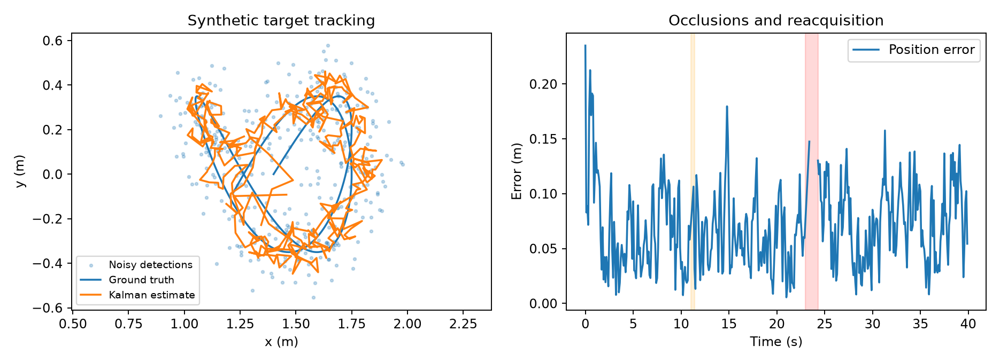

# ROS 腿部追蹤與跟隨

2019 年（108 學年度第一學期）「機器人感知估測」課程期末專案。

系統採用 **掃描分段 → 九項幾何特徵 → Gaussian Naive Bayes → 單目標 Kalman 追蹤 → 跟隨控制** 架構。本文說明專案設計與公開程式的驗證方式；公開實作使用 C++14／Eigen，整合介面以 **ROS Noetic** 為目標。



## 沒有機器人也能驗證

Ubuntu 20.04／22.04 的獨立核心：

```bash
sudo apt-get update
sudo apt-get install -y build-essential cmake libeigen3-dev libgtest-dev python3-numpy python3-matplotlib
cmake -S . -B build -DCMAKE_BUILD_TYPE=Release
cmake --build build -j2
ctest --test-dir build --output-on-failure
python3 tools/evaluate.py --exe build/leg_cli --output results/local
```

輸出包含重新訓練的模型、分類混淆統計、追蹤 CSV、狀態圖、雷射回放圖及 `metrics.json`。合成資料使用固定亂數種子；計時結果隨硬體與編譯器改變。

Windows 可用 Visual Studio 2022 C++ 工具鏈：

```powershell
cmake -S . -B build -G "Visual Studio 17 2022" -DCMAKE_DISABLE_FIND_PACKAGE_GTest=TRUE
cmake --build build --config Release
ctest --test-dir build -C Release --output-on-failure
python tools/evaluate.py --exe build/Release/leg_cli.exe --output results/local
```

Python 圖表工具需要 NumPy 與 Matplotlib。未安裝 Eigen／GoogleTest 時，CMake 會下載固定版本的來源；首次建置需要網路。舊版 MinGW win32 執行緒工具鏈不列為支援的測試環境。

## ROS Noetic

```bash
docker build -t ros-leg-tracking .
docker run --rm ros-leg-tracking
```

容器會建置套件、執行模組單元測試及 ROS 節點整合測試。也可在既有 Noetic catkin workspace 中以 `catkin_make -DBUILD_ROS=ON` 建置，再執行：

```bash
source devel/setup.bash
rostest ros_leg_tracking integration.test
roslaunch ros_leg_tracking offline.launch
```

`offline.launch` 等待 `/scan` 與有效的 TF；它不會自行產生掃描。整合測試會啟動固定機器人的 TF 與合成雷射來源。歷史 rosbag 回放時，先設定 `/use_sim_time=true`，再使用 `rosbag play --clock`，並確保 bag 或外部節點提供相應的 TF。

速度預設發布至 **`cmd_vel_preview`**。只有明確修改 `command_topic` 才會送至其他 topic。公開實作的驗證範圍不包含實機測試；上車前需核對雷射外參、底盤方向及底盤端命令逾時停止。預覽停止保護不等同完整碰撞避免。

## 模組與改善

| 模組 | 職責與改進 |
|---|---|
| `perception.cpp` | 可變長度 LaserScan、無效值過濾、保留掃描間隔的分段、九項特徵、log-domain Gaussian NB |
| `tracking.cpp` | `[x,vx,y,vy]` 線性模型、實際時間差、Mahalanobis gating、Joseph 協方差更新、追蹤生命週期 |
| `control.cpp` | 跟隨距離死區、轉向優先、速度／加速度限制、失去量測立即停發非零命令 |
| `ros/node.cpp` | 量測時間的 TF、odom 追蹤、轉回底盤座標、ROS 與牆鐘雙重逾時檢查 |
| `cli.cpp` | 特徵匯出、模型訓練、分類評估、目標與掃描回放 |

分類位置使用區段質心，與分類特徵分開存放。QR 圓擬合處理退化幾何；模型僅在新時間戳更新。短暫缺測只維持估計，不繼續驅動；超過 0.6 秒遺失後重新確認目標。

## 資料與結果的解讀

- `data/train_features.txt`：原課程 `data` 序列的 127 幀、2,135 個標註區段。
- `data/test_features.txt`：原課程 `data0106` 序列的 489 幀、8,700 個標註區段。
- 特徵由共用 C++ 特徵程式重新計算；完整掃描與 MATLAB 原始檔不放入公開庫。資料來源雜湊與轉換工具一併提供。
- 不同目錄作為序列切分，已排除完全相同影格；無法據此保證原錄製場景或人員彼此獨立。
- 真實資料的分類結果仍有誤判，詳見[實驗報告](docs/RESULTS.md)。合成 demo 模型與歷史資料模型分開，不互相冒充實際準確率。
- 追蹤圖使用已知真值的合成位置量測；掃描圖使用圓形物體的 ray-cast 模擬。跟隨命令圖是開迴路預覽，沒有底盤動力學，也沒有實機跟隨成功率。

## 文件

- [原始問題與改進](docs/IMPROVEMENTS.md)
- [介面、模型及資料格式](docs/DATA_FORMAT.md)
- [測試與實驗結果](docs/RESULTS.md)
- [不署名期末報告](report/final_report.pdf)
- [來源說明](NOTICE.md)

GitHub Actions 會驗證 Linux 核心、記憶體／未定義行為檢查及 ROS Noetic 建置與整合測試。Noetic 已停止官方維護，本專案仍依課程技術脈絡使用它。
