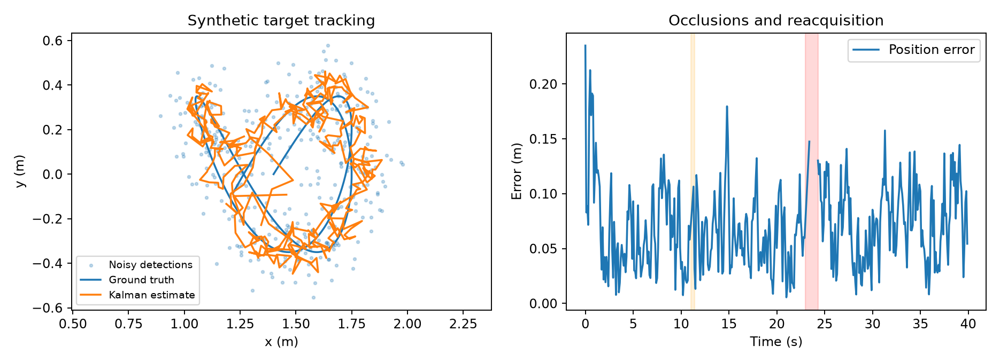
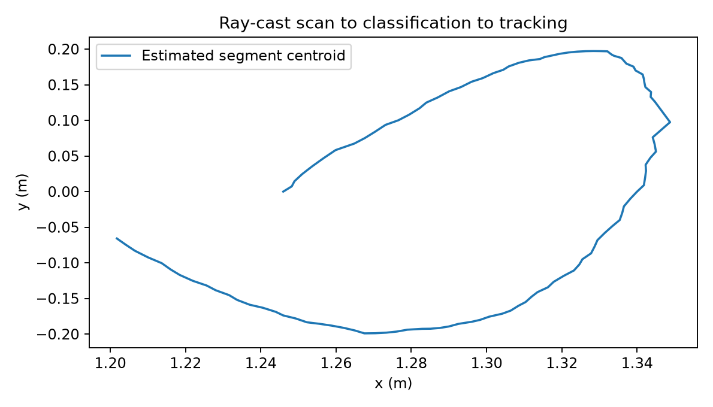

# ROS 腿部追蹤與跟隨

## 機器人感知估測課程期末報告

本報告整理 108 學年度第一學期期末專案的架構與後續改進。系統從二維雷射掃描辨識腿部候選，透過跨影格關聯與線性 Kalman filter 估計位置及速度，再產生跟隨命令。後續工作以 ROS Noetic 為整合目標，將演算法拆成可獨立建置與測試的 C++ 模組。

## 問題與目標

現存原始快照存在分類特徵被當成位置輸出、訓練與推論特徵定義不一致、追蹤時間尺度不一致、協方差公式及資源生命週期不完整等問題。本版先修正資料與數學意義，再建立離線驗證及效能比較，使改善能由程式與測試重現。

## 系統架構

LaserScan → 有效值檢查 → 相鄰點分段 → 九項幾何特徵 → 腿部分類 → 座標轉換 → 預測與資料關聯 → 狀態更新 → 跟隨控制與停止條件。

perception 負責掃描、特徵與分類；tracking 負責線性估測與目標生命週期；control 負責命令限制與停止；ROS adapter 負責訊息、TF 與排程。命令列工具支援資料轉換、訓練、分類及回放。核心沒有 ROS 相依性，讀者沒有機器人仍可驗證。

## 驗證範圍

本版使用保留的課程掃描標註資料及合成場景，沒有新增實體機器人測試。歷史資料實驗評估已標註區段的分類；合成場景評估追蹤、掃描流程及命令預覽。本文不宣稱實機跟隨成功率、多人身份追蹤或完整避障能力。

## 感知模組與模型訓練

掃描使用訊息中的點數、起始角度與角度增量，排除 NaN、Inf 與超出有效距離的量測。相鄰有效點距離超過 0.09 m 或遇到無效點時切段，保留至少 3 點的區段。首尾處理與邊界檢查不再依賴固定 720 點。

九項特徵為點數、相對質心的 RMS 距離、感測距離差、圓擬合殘差平方和、半徑、邊界長度、相鄰點距離的變異數、平均曲率、平均絕對轉角。圓擬合先將座標中心化，再以 column-pivoted QR 求解。共線或退化區段使用明確的半徑 sentinel，避免不穩定反矩陣與除以零。

分類特徵與追蹤位置分開儲存。追蹤使用區段質心，不能以邊界長度或變異量代替座標。每個區段只計算一次特徵，供分類及後續流程使用。

## 一致的訓練與推論

舊 MATLAB 程式與 C++ 對部分特徵的定義不同，因此本版重新用 C++ 計算歷史標註區段的特徵。Gaussian Naive Bayes 對非負特徵取 log1p 後估計各類別均值、變異數與先驗，使用 log-likelihood 累加。變異數下限為 1e-9。

原 data 序列共 127 幀、2,135 個區段。其中第 0–79 幀的 1311 個區段用於估計模型；第 80–89 幀留作時間間隔；第 90–126 幀的 636 個區段用於選擇最大 F1 的分類門檻。門檻為 13.0414，模型不再用驗證資料重新估計均值與變異數。

data0106 的 489 幀、8,700 個區段作為跨序列評估。程式檢查完全相同影格的 SHA-256，未發現重複；這不保證不同場景或人員獨立。開發期間曾查看這個序列的結果，所以它不是封存的盲測集。原標註尚未重新人工審核。

## 追蹤與跟隨控制

追蹤狀態為 [x, vx, y, vy]，位置觀測為 [x, y]。狀態轉移使用實際掃描時間差：x_next = x + vx·dt，y_next = y + vy·dt。過程噪聲由加速度模型建立；量測噪聲的位置標準差為 0.1 m，過程加速度標準差為 0.8 m/s²。

先預測狀態與協方差，再以預測的 innovation covariance 計算 Mahalanobis 距離。候選需通過平方距離 9.21 的門檻；無匹配時不注入虛假的零座標。Kalman gain 以 LDLT 解線性系統，協方差採 Joseph form，並維持對稱性。

新目標連續三次符合條件後確認。短暫缺測進入 Coasting，僅保留估計而停止非零速度；超過 0.6 秒進入 Lost，重新出現的候選需再次確認。重複或倒序時間戳不更新濾波器。

## ROS 整合與停止條件

掃描候選依量測時間從雷射座標轉至 odom 追蹤，再於控制時轉回 base_link。控制以 20 Hz 的牆鐘 Timer 檢查狀態，ROS 時間戳與接收時間皆需保持新鮮，因此回放暫停時也會停止預覽命令。

跟隨距離設定為 0.8 m，距離死區為 0.05 m；線速度上限 0.25 m/s，角速度上限 0.8 rad/s。方向偏差過大時以轉向為主。一般命令限制加速度；缺測、資料過期、TF 失效或近距離障礙則立即輸出零速度。預設發布到 cmd_vel_preview。

目前是單腿目標追蹤，沒有雙腿配對、多目標身份管理或掃描運動去畸變。初始選取範圍以 odom 原點為中心，因此長距離移動部署還需調整選取參考點。實機端仍須具備命令逾時停止，不能依賴上層節點在崩潰後繼續發布零速度。

## 模組驗證

32 項單元測試涵蓋掃描、分段、特徵、座標轉換、分類、模型存取與校準、關聯、Kalman filter、狀態管理、控制及停止條件。數值測試包括已知解析更新、等速度軌跡及 5,000 步協方差正定性／對稱性。ROS 整合測試檢查合成目標、空掃描、缺少 TF、障礙與逾時停止。

## 分類與追蹤結果

跨序列的區段分類結果：TP 913、FP 1014、FN 125、TN 6648。Precision 47.38%，recall 87.96%，F1 0.6159。模型保留多數腿部區段，但誤報仍多，不能直接視為已可可靠部署的腿部偵測器。

合成追蹤使用固定種子 732、400 幀、0.1 秒間隔，包含短暫遮擋、較長遮擋及離群候選。在相同的 376 個「有真實量測且追蹤確認」影格中，原始含雜訊位置 RMSE 為 0.1397 m，濾波後為 0.0777 m。這是合成量測去噪比較，不是原始課程程式與新版的實機比較。

圖中橘色與紅色區間為短暫、較長遮擋。未確認與遺失狀態不列入上述 RMSE，圖表仍顯示完整期間，避免把缺測期間藏在平均數中。

另以 ray-cast 圓形物體產生 120 幀 LaserScan，含 5 幀空掃描；115 幀有分類候選。此項使用獨立的合成模型，驗證完整資料流，不能當作真實腿部辨識準確率。

## 效能與重現方法

本機 Release 建置採 Visual Studio 2022 C++ 工具鏈。特徵對照實驗在每輪 3,000 個區段上比較「相同特徵重算兩次」與「計算一次後重用」，共 21 輪，交錯順序並檢查結果 checksum。中位耗時分別為 12.510 ms 與 6.304 ms，減少 49.6%。此數值只表示重複計算消除的效益。

400 幀追蹤與控制預覽的中位耗時為 0.70 微秒，P95 為 0.80 微秒。120 幀稀疏合成掃描流程中位耗時為 8.00 微秒。短時間測量受計時器、CPU 與負載影響；不含 ROS、I/O 或底盤延遲，不代表即時截止期限保證。

## 無實機重現

1. 安裝 CMake、C++ 編譯器、Eigen、GoogleTest、NumPy 與 Matplotlib。
2. 執行 cmake -S . -B build -DCMAKE_BUILD_TYPE=Release 並建置。
3. 執行 ctest --test-dir build --output-on-failure。
4. 執行 tools/evaluate.py，指定 leg_cli 路徑及輸出目錄。
5. 執行 feature_benchmark 產生特徵耗時比較。
6. 使用 ROS Noetic 容器建置並執行 rostest。

## 結論與後續工作

本次改進建立一致的特徵與位置語意、正確的線性估測流程、明確的目標生命週期及可重現測試。下一步應優先重新審核歷史標註、補充不同場景的負樣本及獨立測試序列，再評估分類模型與身份配對。實機跟隨、底盤動態與長距離移動尚待驗證。

## 參考資料

Eigen：Solving linear least squares systems。https://eigen.tuxfamily.org/dox/group__LeastSquares.html
Welch and Bishop：An Introduction to the Kalman Filter。https://www.cs.unc.edu/~welch/media/pdf/kalman_intro.pdf
scikit-learn：Naive Bayes。https://scikit-learn.org/stable/modules/naive_bayes.html
ROS：rostest。https://index.ros.org/p/rostest/
以上資料用於數學及工具核對；查閱日期 2026-11-07。

